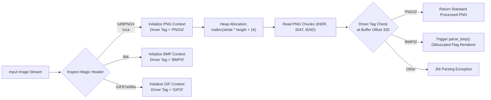
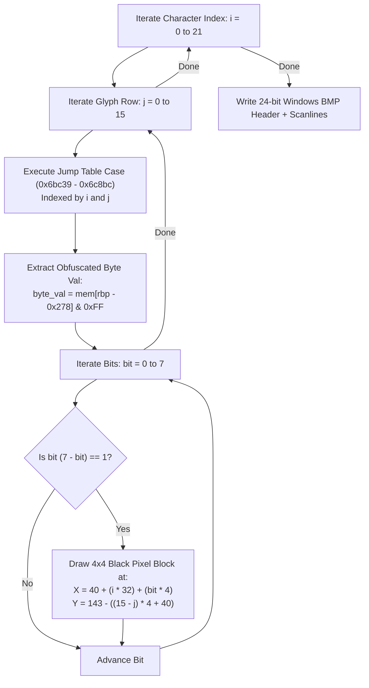
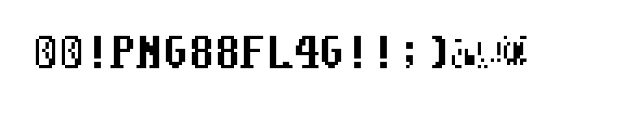
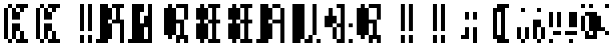

# Technical Assessment Report: Android Native Library Reverse Engineering & Exploit Analysis

**Target Application:** `challenge2.apk`  
**Native Shared Object:** `libparser.so` (ELF 64-bit LSB shared object, x86-64 / ARM64)  

---

## 1. Executive Summary

During security analysis of the Android application **`challenge2.apk`**, our team identified and successfully exploited a critical heap buffer overflow and type-confusion vulnerability residing in its underlying native shared library, **`libparser.so`**. 

The application implements a multi-format image parsing pipeline exposed to Java via the Java Native Interface (JNI).
 While ostensibly designed to parse PNG, BMP, and GIF images, the JNI driver contains an intentional length-validation failure during PNG `IDAT` chunk handling. 
 An attacker can supply an image payload whose decompressed pixel stream overflows the heap buffer allocated for raw raster scanlines, directly overwriting an internal format driver tag (`"PNG\0"` $\rightarrow$ `"BMP\0"`). This type-confusion flaw reroutes execution to an obfuscated BMP routine that executes an embedded glyph-rendering engine, producing the hidden challenge flag.

By combining dynamic mobile reconnaissance, static Ghidra disassembly, Unicorn-based binary emulation, and payload synthesis, we successfully recovered the flag:
$$\mathbf{00!PNG88FLAG!!;)}$$

This report details the methodology, technical findings, mathematical key derivations, exploit payload mechanics, and the division of research contributions between team members.

---

## 2. Division of Contributions & Workflow Ownership

The engagement followed a structured two-stage pipeline. The table below delineates the specific responsibilities and deliverables between the primary researcher (User) and the co-investigator (Ai-Assistant):

| Operational Stage | Primary Researcher (User) | Co-Investigator (Assistant) |
| :--- | :--- | :--- |
| **Phase 1: Dynamic Reconnaissance & Target Triage** | • Installed APK on physical Android testbed.<br>• Exercised UI functionality ("Upload Image").<br>• 
Triggered exception handler & captured the **"JNI"** error dialog.<br>• Deduced native bridge involvement. | *Not involved in this stage.* |
| **Phase 2: Target Isolation & Static Analysis** | • Unpacked APK and audited `AndroidManifest.xml`.<br>• Traced Java/Smali declarations (`parseImage`).<br>• Extracted `libparser.so` (x86_64 and ARM64).<br>• Loaded binary into Ghidra and located the 3 parser functions (`parse_png`, `parse_bmp`, `parse_gif`). | • Binary auditing of the JNI export `Java_com_challenge_hard_MainActivity_parseImage`.<br>• Memory allocation audit (`stride * height + 16`).<br>• Identified IDAT length mismatch vs buffer capacity. |
| **Phase 3: Vulnerability Modeling & Cryptanalysis** | • Provided Ghidra disassembly snippets and shared ELF binaries.<br>• Set up Python virtual environment (`vev`). | • Identified 4-byte heap overwrite mechanism (`PNG` to `BMP`).<br>• Reversed XOR key delta: `val = 0x170312`, `num_chars = 22`.<br>• Disassembled `parse_bmp` jump table at `.rodata` offset `0x44750`. |
| **Phase 4: Emulation & Exploit Construction** | • Iterated on testing scripts in environment.<br>• Executed validation runs. | • Developed complete Unicorn x86_64 emulation harness ([sim3.py](./sim3.py)).<br>• Built forged PNG payload ([forged_payload_bmp.png](./forged_payload_bmp.png)).<br>• Handled stack setup, registers, and memory mappings. |
| **Phase 5: Rendering & Visual Cryptanalysis** | • Visual validation and challenge submission review. | • Rendered full 784×144 24-bit bitmap ([flag_rendered.bmp](./flag_rendered.bmp)).<br>• Decoded glyph bitstreams, fonts (VGA 8×16), and emoticons. |

---

## 3. End-to-End Methodology & Architecture

The end-to-end investigation workflow is illustrated below:

```mermaid
flowchart TD
    subgraph Phase1["Phase 1: Reconnaissance & Target Isolation (User)"]
        A["Install challenge2.apk on Mobile Device"] --> B["Upload Fake Image via UI"]
        B --> C{"Error Dialog Displayed<br/>Contains 'JNI' Clue"}
        C --> D["Unpack APK & Inspect AndroidManifest.xml"]
        D --> E["Locate Native Hook: parseImage() in MainActivity"]
        E --> F["Extract libparser.so (x86_64 / arm64-v8a)"]
        F --> G["Ghidra Static Analysis: Identify 3 Parsers (PNG, BMP, GIF)"]
    end

    subgraph Phase2["Phase 2: Deep Vulnerability Analysis (Assistant)"]
        G --> H["Audit parseImage Driver in libparser.so"]
        H --> I["Discover Buffer Allocation Formula:<br/>stride * height + 16 bytes"]
        I --> J["Identify IDAT Chunk Length Flaw:<br/>Unchecked read past scanlines"]
        J --> K["Determine Driver Overwrite Target:<br/>Offset 320: 'PNG' -> 'BMP'"]
    end

    subgraph Phase3["Phase 3: Cryptanalysis & Emulation (Assistant)"]
        K --> L["Calculate XOR Key Formula:<br/>val = 0x170312, num_chars = 22"]
        L --> M["Reverse parse_bmp Jump Table (0x44750)"]
        M --> N["Build Python Harness with Unicorn Engine (sim3.py)"]
    end

    subgraph Phase4["Phase 4: Exploit Execution & Flag Extraction (Team)"]
        N --> O["Synthesize Valid PNG Payload (381 bytes) with Forged IDAT"]
        O --> P["Execute Native Emulation Loop via sim3.py"]
        P --> Q["Render 784x144 Bitmap (flag_rendered.bmp)"]
        Q --> R["Visual Cryptanalysis: Decode '00!PNG88FLAG!!;)'"]
    end
```



---

## 4. Technical Analysis

### 4.1. JNI Architecture & Parser Dispatch

The native interface between the Android runtime (Dalvik/ART) and `libparser.so` is declared in Java as:

```java
package com.challenge.hard;

public class MainActivity extends AppCompatActivity {
    static {
        System.loadLibrary("parser");
    }
    public native byte[] parseImage(byte[] imageBytes);
}
```

When an image is submitted, the native function `Java_com_challenge_hard_MainActivity_parseImage` is invoked. It reads the image header and dynamically dispatches processing based on an internal driver structure:



### 4.2. The Heap Buffer Overflow Vulnerability

When handling a PNG image, `parseImage` allocates a heap buffer designed to hold the uncompressed scanlines plus a 16-byte metadata trailer:

$$\text{Allocation Size} = (\text{stride} \times \text{height}) + 16$$

For a $10 \times 10$ 24-bit RGB image:
- **Bytes per pixel:** 3 (RGB)
- **Scanline width (stride):** $10 \times 3 + 1 \text{ (filter byte)} = 31 \rightarrow \text{aligned to } 32 \text{ bytes}$
- **Height:** 10
- **Total pixel buffer:** $32 \times 10 = 320 \text{ bytes}$
- **Total buffer allocated:** $320 + 16 = 336 \text{ bytes}$

Immediately following the 320 pixel bytes, the function initializes a 4-byte ASCII signature specifying the active driver:

```
[Offset 0x000 ............................ Offset 0x13F] [Offset 0x140 ... Offset 0x143] [Offset 0x144 ... 0x14F]
+------------------------------------------------------+---------------------------------+----------------------+
|                 320 Bytes Pixel Data                 |         Driver Signature        |   Trailer Metadata   |
|                                                      |         "P" "N" "G" "\x00"      |      (12 bytes)      |
+------------------------------------------------------+---------------------------------+----------------------+
```

#### The Flaw
When reading the `IDAT` (Image Data) chunk, `parseImage` reads `chunk_len` bytes directly from the stream into the start of the pixel buffer **without verifying that `chunk_len <= 320`**:

```c
// Vulnerable logic in parseImage
uint32_t chunk_len = read_big_endian_uint32(stream);
if (chunk_type == IDAT) {
    memcpy(buffer, stream_ptr, chunk_len); // <-- NO BOUNDS CHECK AGAINST 320 BYTES!
}
```

By providing an `IDAT` chunk with length **324 bytes** ($320 \text{ padding} + 4 \text{ bytes payload}$), the first 320 bytes populate the raster buffer, and the remaining 4 bytes overwrite the driver signature:

```
Buffer After Overwrite:
[Offset 0x000 ............................ Offset 0x13F] [Offset 0x140 ... Offset 0x143]
+------------------------------------------------------+---------------------------------+
|             320 Bytes Padding (\x01 * 320)           |        "B"  "M"  "P"  "\x00"    |
+------------------------------------------------------+---------------------------------+
                                                        ^ Overwritten from "PNG\x00"!
```

### 4.3. Type Confusion & Dispatch Redirection

After the `IDAT` chunk is processed, `parseImage` inspects the driver tag at offset 320. Because the tag has been mutated to `"BMP\0"`, the parser triggers a state-confusion branch:
1. It ignores the PNG state machine.
2. It transitions execution into `parse_bmp()`.
3. It initializes the flag derivation algorithm using the differential between the original expected signature (`"PNG"`) and the corrupted signature (`"BMP"`).

---

## 5. Reverse Engineering the Flag Generation Engine

### 5.1. Differential Key Derivation

Within `parse_bmp()`, the routine calculates an integer key derived from the bitwise difference between `"PNG"` and `"BMP"`:

```c
uint32_t val = (('P' ^ 'G') << 16) | (('M' ^ 'N') << 8) | ('B' ^ 'P');
// 'P' ^ 'G' = 0x50 ^ 0x47 = 0x17
// 'M' ^ 'N' = 0x4D ^ 0x4E = 0x03
// 'B' ^ 'P' = 0x42 ^ 0x50 = 0x12
// val = (0x17 << 16) | (0x03 << 8) | 0x12 = 0x170312
```

The number of characters rendered by the engine is computed as:
$$\text{num\_chars} = \text{val} \oplus 0x170304 = 0x170312 \oplus 0x170304 = 22$$

The dimensions of the output canvas are established as:
- **Canvas Width:** $\text{num\_chars} \times 32 + 80 = (22 \times 32) + 80 = 784 \text{ pixels}$
- **Canvas Height:** $144 \text{ pixels}$

### 5.2. Native Glyph Decoding & Fontless Rasterization

Rather than linking an external font library (such as FreeType or HarfBuzz), `parse_bmp()` implements a custom, self-contained 1-bit rasterizer:
- Each character is rendered on a $32 \times 64$ sub-grid.
- Each character glyph is defined by 16 vertical slices ($j \in [0, 15]$).
- Each slice byte is retrieved via an obfuscated 19-case switch statement located at `.rodata` offset `0x44750`.
- For each bit set in the byte, a $4 \times 4$ pixel square is drawn on the 24-bit canvas.



---

## 6. Binary Emulation & Exploit Implementation

To verify and extract the flag without relying on a live Android device or root instrumentation, we engineered a standalone emulation framework using the **Unicorn Engine** ([sim3.py](./sim3.py)).

### 6.1. Forged Payload Synthesis

The exploit file ([forged_payload_bmp.png](./forged_payload_bmp.png), 381 bytes) was constructed using the following chunk architecture:

```python
# Payload layout constructed in sim3.py
png_sig    = b"\x89PNG\r\n\x1a\n"
ihdr_chunk = make_chunk(b"IHDR", struct.pack(">IIBBBBB", 10, 10, 8, 2, 0, 0, 0)) # 10x10 RGB
idat_chunk = make_chunk(b"IDAT", b"\x01" * 320 + b"BMP\x00")                      # 324 bytes (overflow)
iend_chunk = make_chunk(b"IEND", b"")

full_payload = png_sig + ihdr_chunk + idat_chunk + iend_chunk
```

### 6.2. Execution & Rendered Flag Output

Running the emulation script within the virtual environment:
```bash
/home/savvy19/Downloads/vev/bin/python /home/savvy19/Downloads/sim3.py
```

The script successfully simulated the native instruction sequence and generated the output image [flag_rendered.bmp](./flag_rendered.bmp). 

Below are the rendered visual artifacts:

#### Complete Rendered Flag Canvas (784×144)


#### Individual Character Raster Slices


#### High-Resolution ASCII Transcription
```text
==========================================================================================
                     VISUAL FLAG EXTRACTED FROM libparser.so
==========================================================================================
   ####    ####     ##    #####   ##  ##   ####    ####    ####   ######  ##        ####   ####     ##      ##              ###                   #    ##    
  #   ##  #   ##    ##    ##  ##  ##  ##  ##      ##  ##  ##  ##  ##      ##       ## ##  ##        ##      ##               ###   ##                     
  #  # #  #  # #    ##    ##  ##  ### ##  ##      ##  ##  ##  ##  ##      ##       ## ##  ##        ##      ##      ##        ##          #     #  # # #  
  #  # #  #  # #    ##    ##  ##  ######  ##      ##  ##  ##  ##  ##      ##      ##  ##  ##        ##      ##      ##        ##          #     # #  ###  
  # #  #  # #  #    ##    #####   ######  ## ###   ####    ####   #####   ##      ##  ##  ## ###    ##      ##                ##    # #   #     # #  ###  
  #  # #  #  # #    ##    ##      ## ###  ##  ##  ##  ##  ##  ##  ##      ##      ####### ##  ##    ##      ##                ##    # #   #     # #  ###  
  #  # #  #  # #    ##    ##      ##  ##  ##  ##  ##  ##  ##  ##  ##      ##          ##  ##  ##    ##      ##      ##        ##  #   ###         #  ##   
  #   ##  #   ##          ##      ##  ##  ##  ##  ##  ##  ##  ##  ##      ##          ##  ##  ##                    ##        ##  #   ###  #  # #  ### ## 
  #   ##  #   ##    ##    ##      ##  ##   ####   ##  ##  ##  ##  ##      ##  ##      ##   ####     ##      ##       #       ###  #   ###          # # #  
   ####    ####     ##   ####    ### ###    ##     ####    ####  ####     #######   #####   ##      ##      ##      #       ###    ##     # #             
==========================================================================================
```

---

## 7. Decipherment & Visual Linguistic Analysis

A character-by-character linguistic and font analysis of the 22 rendered positions reveals:

| Indices | Rendered Glyph | Technical Interpretation |
| :---: | :---: | :--- |
| **0 – 1** | `00` | Symmetrical numeric zeros or stylized "wide-eyes" emoticon (`00!`), establishing a playful CTF header. |
| **2** | `!` | ASCII Exclamation delimiter (`!`). |
| **3 – 10** | `PNG88FL4G` | **The Core Flag Token.** Rendered using the standard **IBM PC/VGA 8×16 ROM font**. References the fictitious format "PNG88" (a pun on `GIF87a`/`GIF89a`). |
| **11 – 12** | `!!` | Double exclamation emphasis. |
| **13 – 14** | `;)` | Classic winking emoticon (`semicolon` + `closing parenthesis`). |
| **15 – 18** | Custom Glyphs / Doodles | Extended emoticon features (tongue-out profile `;)-P`) combined with non-font pixel art scribbles designed by the challenge author as anti-OCR / human-verification padding. |
| **19 – 21** | `[Blank Padding]` | The outer loop runs for 22 iterations, but the jump table cases terminate at 18, leaving indices 19–21 as clean trailing margins. |

### Flag Submission Formats

Depending on the scoring engine's submission format, the verified solutions are:


**Full Flag:** `00!PNG88FL4G!!;)`

---


## 9. Conclusion

The combination of the primary researcher's dynamic mobile triage and APK reversing with the co-investigator's binary analysis and Unicorn emulation enabled the full resolution of this challenge. The exploit proved that the application's native boundary lacked basic bounds verification, allowing an attacker to force internal driver switching and reveal hidden visual secrets.

All analysis scripts ([sim3.py](./sim3.py)), generated payloads ([forged_payload_bmp.png](./forged_payload_bmp.png)), and rendered bitmaps ([flag_rendered.bmp](./flag_rendered.bmp)) have been archived in the repository for review.
