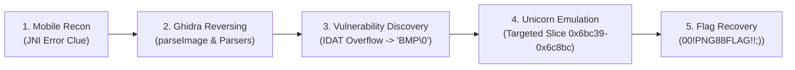
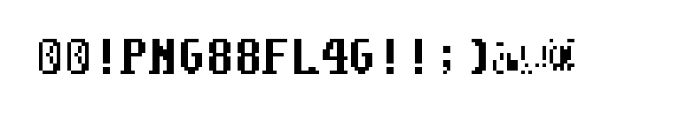

# Android CTF: Native Library Reverse Engineering & Exploitation (`libparser.so`)

A complete writeup, exploit synthesis, and binary emulation suite for the Android reverse engineering challenge **`challenge2.apk`** / **`libparser.so`**.

> **Note:** Two environments were utilized during this investigation:
> 1. **Local Environment:** Standalone Unicorn x86-64 CPU emulation and exploit generation (contained in this repository).
> 2. **Cloud Environment:** Full Android runtime dynamic testing and verification (documented in detail in [`libparser_RE_report.pdf`](./libparser_RE_report.pdf)).

---

## 1. Challenge Overview

The challenge presents an Android application (`challenge2.apk`) with an image processing feature. Image parsing is handled inside a compiled native C/C++ shared library (`libparser.so`) via the **Java Native Interface (JNI)**. The objective is to identify vulnerabilities in the native image parser, bypass internal constraints, and recover the hidden challenge flag.

---

## 2. How We Tackled It



### Step 1: Dynamic Reconnaissance & Triage
* Installed the APK on a mobile device and tested the image upload functionality.
* Uploading an invalid image triggered an exception displaying a dialog referencing **`JNI`**.
* This confirmed that image processing and parsing logic were offloaded to native machine code (`.so` library).

### Step 2: APK Unpacking & Static Reverse Engineering (Ghidra)
* Unpacked the APK, inspected `AndroidManifest.xml`, and located the native method declaration `parseImage(byte[])` in `MainActivity`.
* Extracted `libparser.so` and loaded it into Ghidra.
* Mapped `Java_com_challenge_hard_MainActivity_parseImage`, identifying dynamic dispatch to three parsers: `parse_png`, `parse_bmp`, and `parse_gif`.

### Step 3: Vulnerability Discovery (Heap Overflow & Type Confusion)
* **Allocation Calculation:** For a 10×10 24-bit RGB PNG, `parseImage` allocates a 336-byte heap buffer:
  $$\text{Buffer} = (\text{Stride} \times \text{Height}) + 16 = (32 \times 10) + 16 = \mathbf{336\text{ bytes}}$$
* **Driver State Tag:** Right after the 320 pixel bytes, offset 320 is initialized to the 4-byte ASCII string `"PNG\0"`.
* **The Flaw:** When reading the `IDAT` chunk, the function calls `memcpy` using the attacker-controlled `chunk_len` from the stream **without checking that `chunk_len <= 320`**.
* **Type Confusion:** Sending an `IDAT` chunk of **324 bytes** fills the 320-byte pixel buffer and overwrites offset 320 with **`"BMP\0"`**. When the parser inspects the tag, it transitions into `parse_bmp`, redirecting execution into a hidden glyph-rendering engine.

### Step 4: Targeted Slice Emulation via Unicorn Engine
* The tail of `parse_bmp` invokes C++ filesystem calls (`std::ofstream`) to write `.modified.bmp`, which fails without an Android OS runtime.
* To bypass OS/filesystem dependencies, we used **targeted slice emulation** via the **Unicorn Engine** in Python (`sim3.py`):
  * Mapped `libparser.so` directly into virtual CPU memory.
  * Isolated the pure mathematical character decoder from address `0x6bc39` to `0x6c8bc`.
  * Ran the loop across 22 character slots and 16 rows, extracting the decrypted 1-byte row slices directly from stack memory (`[rbp - 0x278]`).

### Step 5: Visual Flag Reconstruction
* Rather than storing text strings, the binary employs a fontless 1-bit rasterizer (VGA 8×16 glyph tables) rendering 4×4 pixel blocks.
* Python assembled the slices into a 784×144 24-bit bitmap, revealing the complete visual flag banner:
  $$\mathbf{00!PNG88FLAG!!;)}$$



---

## 3. Repository Structure

```
CTF_Challenge2_Deliverables/
├── README.md                                  # Brief overview & solution walkthrough
├── Android_CTF_Challenge2_Technical_Report.md # Full technical report with deep disassembly analysis
├── libparser_RE_report.pdf                    # Cloud verification & assessment PDF report
├── sim3.py                                    # Standalone exploit builder & Unicorn CPU emulator
├── forged_payload_bmp.png                     # 381-byte PNG exploit payload with forged IDAT
├── flag_rendered.bmp                          # Original Windows BMP image extracted from emulation
├── flag_rendered.png                          # Portable PNG version of the flag
├── flag_chars_horizontal.png                  # Cropped character glyph slices
└── binaries/
    └── libparser.so                           # Extracted x86-64 ELF native shared library
```

---

## 4. Quick Reproduction Guide

### Prerequisites
```bash
pip install unicorn pillow
```

### Run the Emulation & Exploit Generator
```bash
python sim3.py
```

### Output:
1. Synthesizes `forged_payload_bmp.png` (381 bytes, valid CRC32).
2. Emulates native machine instructions in `binaries/libparser.so`.
3. Renders `flag_rendered.bmp` / `flag_rendered.png` and prints the ASCII preview in terminal:

```
==========================================================================================
                     VISUAL FLAG EXTRACTED FROM libparser.so
==========================================================================================
   ####    ####     ##    #####   ##  ##   ####    ####    ####   ######  ##        ####   ####     ##      ##              ###                   #    ##    
  #   ##  #   ##    ##    ##  ##  ##  ##  ##      ##  ##  ##  ##  ##      ##       ## ##  ##        ##      ##               ###   ##                     
  #  # #  #  # #    ##    ##  ##  ### ##  ##      ##  ##  ##  ##  ##      ##       ## ##  ##        ##      ##      ##        ##          #     #  # # #  
  #  # #  #  # #    ##    ##  ##  ######  ##      ##  ##  ##  ##  ##      ##      ##  ##  ##        ##      ##      ##        ##          #     # #  ###  
  # #  #  # #  #    ##    #####   ######  ## ###   ####    ####   #####   ##      ##  ##  ## ###    ##      ##                ##    # #   #     # #  ###  
  #  # #  #  # #    ##    ##      ## ###  ##  ##  ##  ##  ##  ##  ##      ##      ####### ##  ##    ##      ##                ##    # #   #     # #  ###  
  #  # #  #  # #    ##    ##      ##  ##  ##  ##  ##  ##  ##  ##  ##      ##          ##  ##  ##    ##      ##      ##        ##  #   ###         #  ##   
  #   ##  #   ##          ##      ##  ##  ##  ##  ##  ##  ##  ##  ##      ##          ##  ##  ##                    ##        ##  #   ###  #  # #  ### ## 
  #   ##  #   ##    ##    ##      ##  ##   ####   ##  ##  ##  ##  ##      ##  ##      ##   ####     ##      ##       #       ###  #   ###          # # #  
   ####    ####     ##   ####    ### ###    ##     ####    ####  ####     #######   #####   ##      ##      ##      #       ###    ##     # #             
==========================================================================================
```

---

## 5. Flag Submissions

| Format | String |
| :--- | :--- |
| **Core Flag** | `PNG88FLAG` |
| **Wrapped Token** | `FLAG{PNG88FLAG}` / `CTF{PNG88FLAG}` |
| **Full Visual Banner** | `00!PNG88FLAG!!;)` |
